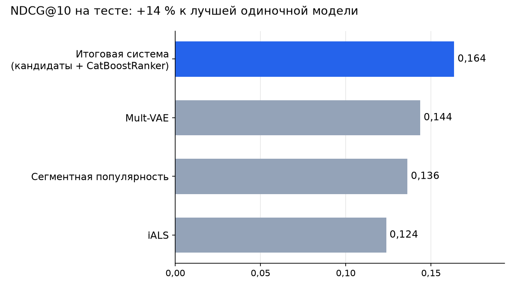

# Двухуровневая рекомендательная система фильмов на данных KION

<!-- header -->
<p align="center">
  
  
  
  
  
</p>

<p align="center"></p>

Кандидатов отбирают три модели: сегментная популярность, iALS и Mult-VAE. Затем CatBoostRanker ранжирует их по 34
признакам, которые для каждого дня считаются только по прошлым данным. Рядом — четыре работы, которые к этому ведут:
метрики, бейзлайны и EASE, матричные разложения, ALS и NCF.

## Задача и данные

По истории просмотров онлайн-кинотеатра KION (МТС) нужно порекомендовать каждому пользователю 10 фильмов «на завтра».
Обучение — 4,87 млн интеракций 880 тыс. пользователей за 13.03–12.08.2021, тест — следующие 10 дней; 37,8 % пользователей
теста холодные, их нет в обучении.

## Результат

**NDCG@10 = 0,164 на тесте — примерно на 14 % выше лучшей одиночной модели (Mult-VAE, 0,144).**

| Модель | NDCG@10 | MAP@10 | Recall@10 |
|---|---:|---:|---:|
| Итоговая система: кандидаты + CatBoostRanker (YetiRank) | **0,1636** | **0,1285** | **0,259** |
| Mult-VAE | 0,1437 | 0,1114 | 0,233 |
| Сегментная популярность | 0,1362 | 0,1088 | 0,213 |

* Тест — 17 320 групп «пользователь × день». Модель и обработка холодных пользователей выбраны по валидации, тест
  использован только для итоговой оценки.
* Рекомендации «на завтра» построены для 1 058 084 пользователей: 118 млн строк кандидатов, обработка чанками
  по 50 тыс. пользователей.
* Самый важный признак — скор Mult-VAE (52 % суммарной важности); направления SHAP проверены на осмысленность и утечки.

Остальные работы:

| Работа | Данные | Результат |
|---|---|---|
| [Метрики качества](lab1_metrics.ipynb) | примеры из вебинара | реализованы Hit rate, Precision и Recall (в том числе денежные), MAP@k, AUC@k, NDCG@k, MRR@k |
| [Бейзлайны и EASE](lab2_baselines_ease.ipynb) | KION | EASE лучше TopPopular: MAP@10 0,086 против 0,066 |
| [Матричные разложения](lab3_matrix_factorization.ipynb) | MovieLens 1M | NDCG@100: SVD 0,275, iALS 0,285, iALS на позитивах и негативах с затуханием по времени 0,296; своя iALS на NumPy совпала с `implicit` (0,2853 против 0,2852) |
| [ALS, BPR и NCF](lab4_als_ncf.ipynb) | KION | NCF на мини-батчах: NDCG@10 0,167 и Recall@50 0,361 против 0,166 и 0,335 у TopPopular; разобрано, почему NCF из шаблона не обучается |

Ответы на задания курса по пунктам — в [docs/assignments.md](docs/assignments.md).

## Стек

Python 3.11 · pandas · NumPy · SciPy · scikit-learn · implicit · PyTorch (MPS) · CatBoost · SHAP · matplotlib · Jupyter

## Структура и запуск

```
.
├── final_project_two_stage.ipynb      # двухуровневый пайплайн — основная работа
├── lab1_metrics.ipynb                 # метрики качества
├── lab2_baselines_ease.ipynb          # TopPopular, окно популярности, EASE
├── metric_tests.py                    # тесты метрик для lab2
├── lab3_matrix_factorization.ipynb    # SVD и iALS
├── lab4_als_ncf.ipynb                 # ALS, iALS, BPR и NCF
├── docs/assignments.md                # задания и ответы
└── requirements.txt
```

```bash
python3.11 -m venv .venv && source .venv/bin/activate
pip install -r requirements.txt
jupyter lab
```

Тетрадки запускаются из корня репозитория и сами скачивают данные в `data/`; в git данные не входят.

| Тетрадка | Данные (скачиваются автоматически) | Полный прогон на M3 Max |
|---|---|---|
| `lab1_metrics.ipynb` | не нужны | секунды |
| `lab2_baselines_ease.ipynb` | KION: `interactions.csv`, `items.csv` ([соревнование МТС](https://ods.ai/competitions/competition-recsys-21/data)) | ≈ 1 мин |
| `lab3_matrix_factorization.ipynb` | [MovieLens 1M](https://grouplens.org/datasets/movielens/1m/) | ≈ 22 мин |
| `lab4_als_ncf.ipynb` | KION: `interactions.csv` | ≈ 31 мин |
| `final_project_two_stage.ipynb` | `train.csv`, `test.csv`, `users.csv`, `items.csv` с Google Drive курса (через `gdown`) | ≈ 34 мин |

Быстрый отладочный прогон финального проекта на 15 % пользователей: `RECSYS_QUICK=1 jupyter lab`.

---

Выполнено в рамках курса «Рекомендательные системы» магистратуры ПМИ ПГНИУ, 2026.
